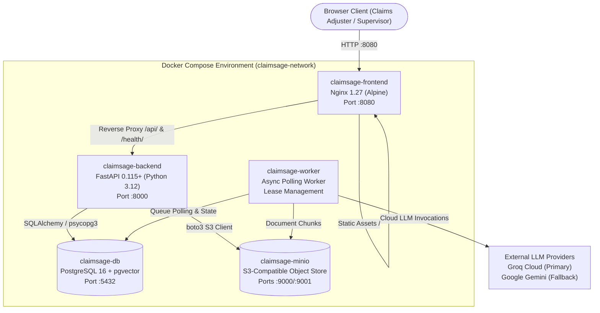
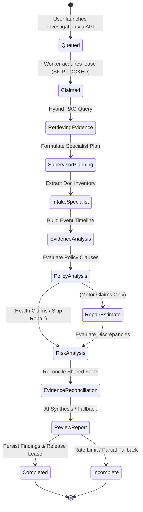

# ClaimSage System Architecture & Technical Specifications

This document details the architectural blueprint of ClaimSage, illustrating component relationships, data flow, container topology, and state transitions.

---

## 1. Container Topology & Network Architecture

---

## 2. Asynchronous Investigation Execution Lifecycle

---

## 3. Storage Layer Architecture
- **Relational Tables**: Store users, claims, versioned policies, policy clauses, investigation state, and audit logs.
- **pgvector Vector Column**: `document_chunks.embedding` and `policy_chunks.embedding` are stored as `Vector(384)` indexed with HNSW / Cosine similarity.
- **MinIO Object Storage**: Claim PDFs and policy documents are stored as raw binary objects indexed by UUID-based keys.
- **Audit Outbox**: Customer email drafts and system notifications are stored in durable relational outbox tables prior to sandboxed or SMTP dispatch.
