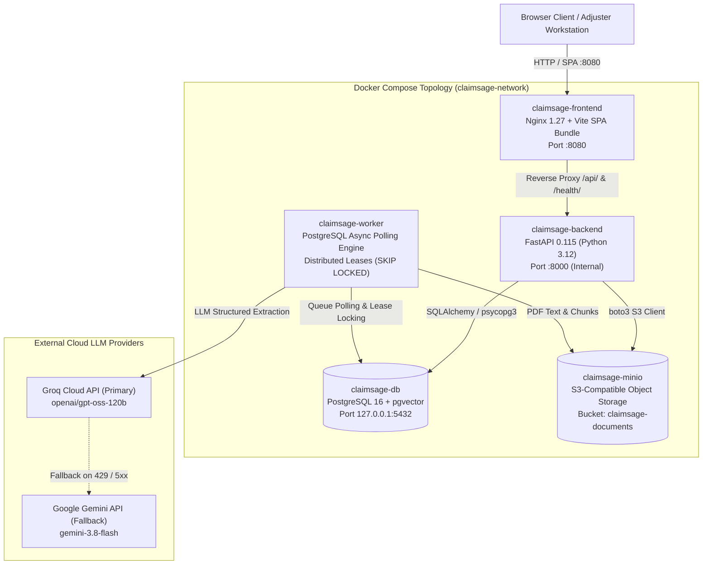
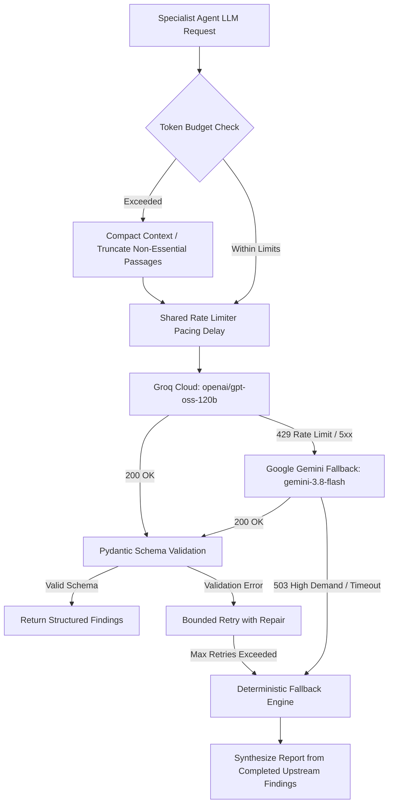
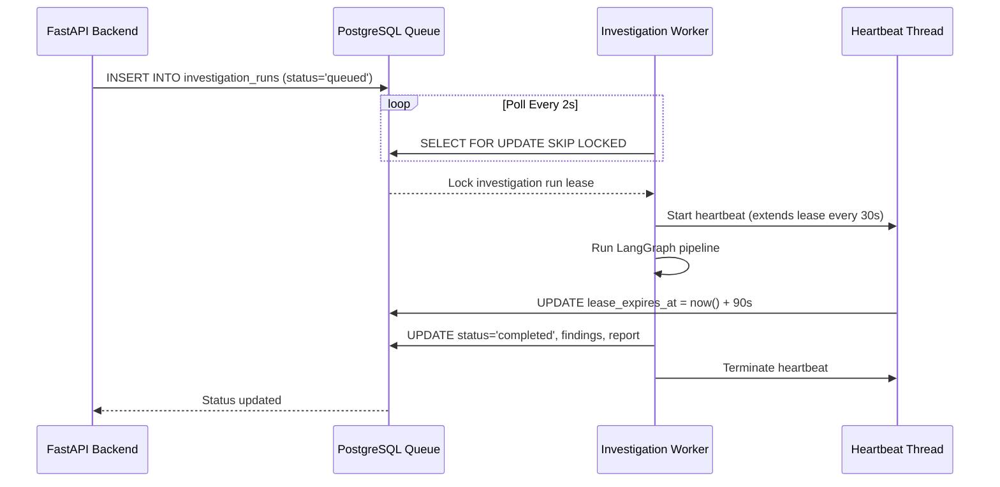

# ClaimSage — System Architecture & Technical Blueprint

This document specifies the technical architecture of **ClaimSage**, detailing container topologies, component boundaries, data relationships, multi-agent orchestration, token budgeting, storage systems, and security perimeters.

---

## 1. System Topology & Container Architecture

ClaimSage executes as an orchestrated set of containerized services managed via Docker Compose on an isolated network (`claimsage_network`).

---

## 2. Component Responsibilities

| Container / Service | Role & Scope | Key Technologies |
| :--- | :--- | :--- |
| **`claimsage-frontend`** | Employee portal, claim workspaces, inline document preview, review queue, findings inspector, and audit explorer. Proxies backend API requests. | React 19, TypeScript, Vite, Tailwind CSS, Lucide icons, Sonner, Axios |
| **`claimsage-backend`** | REST API gateway, JWT authentication, RBAC authorization, claim lifecycle endpoints, document ingestion, and health monitors. | FastAPI, Pydantic v2, PyJWT, Argon2 (`pwdlib`), SQLAlchemy 2.0 |
| **`claimsage-worker`** | Background job processor executing long-running multi-agent LangGraph investigations with heartbeat lease extension and idempotent retries. | Python 3.12, LangGraph 1.2+, `tiktoken`, `sentence-transformers` |
| **`claimsage-db`** | Primary relational datastore, `pgvector` (`Vector(384)`) embedding store for contextual dense retrieval, audit trail repository, and PostgreSQL-backed queue coordination. | PostgreSQL 16, `pgvector 0.3.6` |
| **`claimsage-minio`** | Durable, S3-compatible object storage storing original claim evidence PDFs, invoices, medical records, and policy wordings. | MinIO S3 API |

---

## 3. Multi-Agent LangGraph Workflow

Investigations execute deterministically through a directed acyclic graph managed by **LangGraph**:

```mermaid
flowchart LR
    Start([Launch Run]) --> Retrieval[Two-Pass Contextual RAG]
    Retrieval --> Supervisor[Supervisor Agent]
    Supervisor --> Intake[Claim Intake Specialist]
    Intake --> Evidence[Evidence Analyst]
    Evidence --> Policy[Policy Analyst]
    Policy --> Branch{Claim Type?}
    Branch -->|Motor Claim w/ Estimate| Repair[Repair Estimate Analyst]
    Branch -->|Health Claim / Standard| Risk[Risk & Anomaly Agent]
    Repair --> Risk
    Risk --> Reconcile[Evidence Reconciliation]
    Reconcile --> Report[Review & Report Agent]
    Report --> End([Persist Report & Release Lease])

    subgraph Guardrails ["Deterministic Guardrails"]
        TBM["Token Budget Manager"]
        SRL["Shared Rate Limiter (PostgreSQL)"]
        PV["Provenance & Quote Validator"]
        DF["Deterministic Fallback Engine"]
    end
```

### Agent Roles & Contracts

1. **Supervisor Agent (`SupervisorPlan`)**:
   - Inspects claim metadata, loss details, and available files.
   - Selects which specialist agents to activate and identifies critical verification objectives.
2. **Claim Intake Specialist (`IntakeDocumentOutput`)**:
   - Catalogs uploaded documents, verifies legibility, checks file types, and identifies missing required intake documentation.
3. **Evidence Analyst (`EvidenceAnalysisOutput`)**:
   - Extracts chronological medical and loss events, itemizes billing lines, cross-checks dates, and records supporting verbatim quotes with document IDs.
4. **Policy Analyst (`PolicyAnalysisOutput`)**:
   - Retrieves active policy schedules, compares loss particulars against sub-limits, deductibles, waiting periods, and exclusions.
5. **Repair Estimate Analyst (`RepairEstimateExtraction`)** *(Motor claims only)*:
   - Validates labor charges, part replacement costs, paint refinishing allowances, and depreciation schedules against insurer guidelines.
6. **Risk & Anomaly Agent (`RiskAnalysisOutput`)**:
   - Detects billing inflation, unbundled procedural codes, timeline anomalies, and conflicting document statements.
7. **Review & Report Agent (`SynthesizedReportOutput`)**:
   - Aggregates findings from all specialists into an executive investigation report, attaches verified source citations, and computes preliminary risk posture.

---

## 4. LLM Provider Integration & Fallback Strategy

ClaimSage implements a resilient, three-tier model hierarchy:

- **Primary Provider**: **Groq Cloud** (`openai/gpt-oss-120b`) provides fast token throughput for complex structured JSON generation.
- **Secondary Fallback**: **Google Gemini** (`gemini-3.8-flash`) acts as an immediate failover when Groq returns 429 rate limits or network connection errors.
- **Tertiary Deterministic Fallback**: If all external cloud LLM providers are unavailable or fail validation, ClaimSage synthesizes an auditable investigation report directly from validated upstream findings without crashing or aborting the investigation run.

---

## 5. Storage & Evidence Architecture

1. **Object Storage (MinIO)**:
   - Uploaded PDF documents are encrypted and stored in `claimsage-documents`.
   - Keys follow UUID patterns (`{claim_id}/{document_id}.pdf`).
   - SHA-256 hashes are verified upon upload and checked before retrieval.
2. **Two-Pass Contextual Dense Retrieval**:
   - **Chunking & Extraction**: PDFs are extracted page-by-page using PyMuPDF (`fitz`) with automatic Tesseract OCR fallback (`< 30` native chars) and split into **1,000-character chunks with 150-character overlap** (`DEFAULT_CHUNK_SIZE = 1000`, `DEFAULT_CHUNK_OVERLAP = 150`).
   - **Dense Vectors**: 384-dimensional dense vectors generated by `sentence-transformers/all-MiniLM-L6-v2` stored in PostgreSQL `pgvector` `Vector(384)` columns on `claim_evidence_chunks` and `policy_chunks`.
   - **Pass 1 (Authorized Cosine Similarity Recall)**: Enforces claim-level RBAC and policy version/effective-date access grants in SQL, then computes `pgvector` cosine similarity (`1.0 - embedding.cosine_distance(query_embedding)`) across a broad candidate pool (`max(top_k * 3, 15)` for evidence, `max(top_k * 2, 10)` for policy) filtered by `min_similarity`.
   - **Pass 2 (Per-Document Diversity & Deduplication)**: Enforces per-document diversity caps (`max_chunks_per_doc = 3` for claim evidence, `4` for policy documents), deduplicates identical passages via SHA-256 content hashes, backfills remaining slots up to `top_k`, and returns passages ordered by `(filename, page_number, chunk_index)` for `TokenBudgetManager` prompt assembly.

---

## 6. Queue & Worker Architecture

- **Concurrency & Fencing**: Multiple workers can poll `investigation_runs` concurrently using PostgreSQL row-level locks (`FOR UPDATE SKIP LOCKED`).
- **Heartbeat & Lease Recovery**: If a worker node crashes or loses network connectivity, its 90-second lease expires and another healthy worker safely reclaims the job.
- **Worker Fencing**: Stale workers that wake up after losing a lease detect rowcount mismatches and abort immediately without overwriting state.

---

## 7. Security Boundaries & Guardrails

- **Mandatory Human Decision Making**: AI agents are strictly restricted from issuing final claim approvals, denials, or settlement payouts. All report outputs carry `human_review_required=True`.
- **Claim Isolation**: Role-based access controls verify that adjusters can only view claims assigned to their team or user ID; team leads access team claims; administrators access all claims.
- **Source Citation Provenance**: Every finding citing evidence must reference a valid `evidence_id`, `document_id`, `page_number`, and matching text snippet. Hallucinated quotes are stripped during report validation.
- **Sandboxed Communications**: Customer inquiry emails are held in `customer_emails` in `draft` status until an employee explicitly approves or modifies the message.
