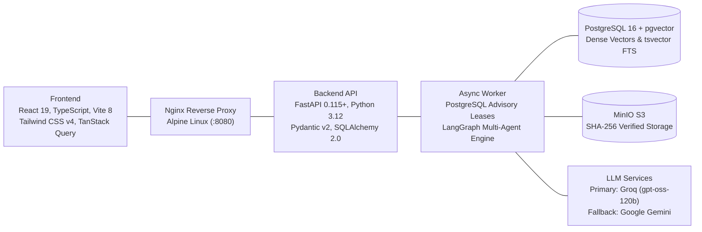
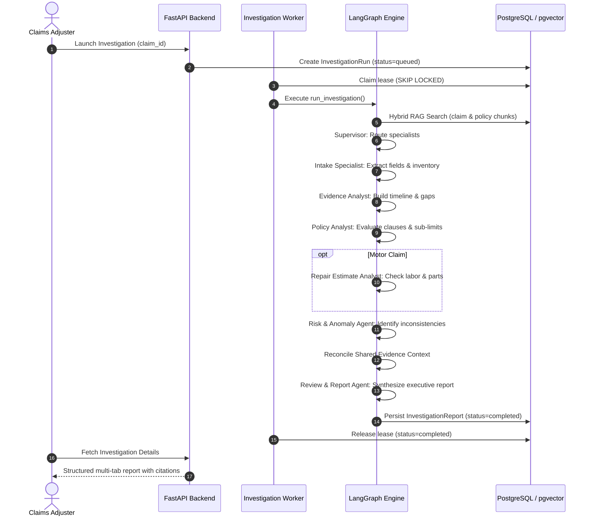
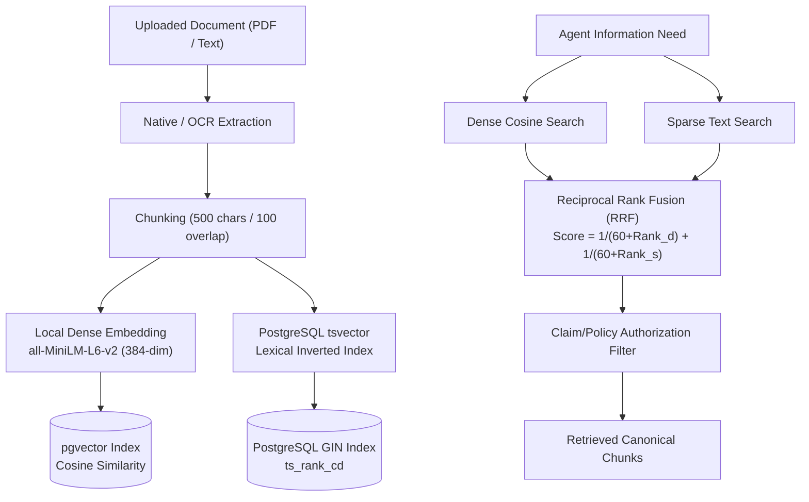

# ClaimSage — Comprehensive Project Report & System Specification

**Project**: ClaimSage (Enterprise AI-Powered Insurance Claims Investigation Assistant)  
**Date**: November 2026  
**Status**: Implementation Complete & GitHub Pre-Delivery Audit Approved  
**Repository**: `D:\ClaimSage-v2-clean`

---

## Table of Contents
1. [Abstract](#1-abstract)
2. [Introduction](#2-introduction)
3. [Problem Statement](#3-problem-statement)
4. [Objectives](#4-objectives)
5. [Scope](#5-scope)
6. [System Requirements](#6-system-requirements)
7. [Technology Stack](#7-technology-stack)
8. [System Architecture](#8-system-architecture)
9. [Multi-Agent System Design](#9-multi-agent-system-design)
10. [RAG Implementation & Contextual Retrieval](#10-rag-implementation--contextual-retrieval)
11. [Database Design & Data Integrity](#11-database-design--data-integrity)
12. [API Architecture & Interface Contracts](#12-api-architecture--interface-contracts)
13. [Security, Privacy & Compliance](#13-security-privacy--compliance)
14. [Implementation Details & Reliability Engineering](#14-implementation-details--reliability-engineering)
15. [Testing Methodology & Verified Test Results](#15-testing-methodology--verified-test-results)
16. [Known Limitations](#16-known-limitations)
17. [Future Scope & Production Roadmap](#17-future-scope--production-roadmap)
18. [Conclusion](#18-conclusion)

---

## 1. Abstract
ClaimSage is an enterprise-grade artificial intelligence investigation copilot designed for insurance claims adjusters, policy specialists, and supervisory teams. Built upon an asynchronous LangGraph multi-agent architecture and a Contextual Hybrid Retrieval-Augmented Generation (RAG) pipeline, ClaimSage automates the labor-intensive synthesis of medical records, billing statements, police reports, and complex policy terms. By enforcing deterministic pre-invocation token budgeting, bidirectional evidence reconciliation, verbatim quote validation, and strict decision boundaries, ClaimSage ensures zero autonomous coverage adjudications while accelerating investigation throughput and preserving complete auditability.

---

## 2. Introduction
Modern insurance claim operations operate under stringent regulatory oversight and high administrative overhead. In health and motor claims processing, adjusters must reconcile ambiguous claimant statements against technical policy wordings that specify intricate coverage schedules, room-rent limits, depreciation rates, and policy exclusions. 

Traditional approaches either rely on manual, error-prone human audits or generic conversational AI tools that lack domain grounding, emit hallucinated clause references, and lack deterministic safety controls. ClaimSage addresses this operational void by introducing a dedicated, evidence-grounded multi-agent platform that treats document evidence as strictly verifiable data.

---

## 3. Problem Statement
The primary failure modes of AI in insurance claims processing include:
1. **Hallucinated Citations**: Language models inventing policy clauses or quoting non-existent billing entries.
2. **Context Window Exhaustion**: Disparate medical or vehicle repair records exceeding model token limits, causing silent truncation of crucial exclusions or evidence.
3. **Premature Adjudication**: Unconstrained models making definitive coverage denials or fraud accusations, creating legal and regulatory liability.
4. **Provider Fragility**: Investigation workflows crashing abruptly upon encountering third-party API rate limits (HTTP 429).
5. **Cross-Document Inconsistencies**: Specialists independently evaluating documents without reconciling verified facts against missing-information checklists.

---

## 4. Objectives
- **Strict Grounding**: Every observation, interpretation, and anomaly must be tied to a canonical `evidence_id` / `chunk_id` and supported by an exact verbatim source substring.
- **Decision Support, Not Decision Automation**: Enforce hard programmatic boundaries preventing the AI system from approving, denying, settling, or paying claims.
- **Workflow Resilience**: Isolate specialist executions so that downstream provider failures preserve upstream findings and trigger deterministic synthesis rather than catastrophic failure.
- **Enterprise Security**: Provide full role-based access control (RBAC), immutable audit event logging, and sandboxed communications.

---

## 5. Scope
- **Supported Claim Domains**: Health insurance claims (hospitalization, surgery, room rent sub-limits) and Motor insurance claims (vehicle collision, repair estimates, line-item depreciation).
- **Supported Formats**: Unstructured PDF documents, structured billing summaries, plain text incident reports, and versioned policy documents.
- **Operational Boundaries**: Decision support for authenticated insurance employees; real claimants do not directly interact with the AI agents. Outbound communications are held in a secure database outbox by default.

---

## 6. System Requirements

### Hardware & Runtime
- **CPU**: 4+ cores recommended (local embedding generation utilizes multi-threaded CPU SIMD).
- **RAM**: 8 GB minimum (16 GB recommended for running full Docker Compose stack).
- **Disk**: 10 GB free space for Docker images, vector storage, and MinIO document objects.
- **OS**: Linux, macOS, or Windows 10/11 with WSL2 / Docker Desktop.

### Software Prerequisites
- Docker Engine 24.0+ & Docker Compose v2.20+
- Python 3.12+
- Node.js 20+ & npm 10+
- PostgreSQL 16 with `pgvector` extension

---

## 7. Technology Stack



---

## 8. System Architecture
The platform is organized into five isolated containerized microservices managed via Docker Compose:
1. `claimsage-frontend`: High-performance Nginx server hosting the compiled React 19 single-page application.
2. `claimsage-backend`: FastAPI REST service exposing authenticated endpoints for claims, policies, investigations, and audit logs.
3. `claimsage-worker`: Standalone asynchronous worker process pulling queued investigation tasks using PostgreSQL row-level locks (`FOR UPDATE SKIP LOCKED`).
4. `claimsage-db`: PostgreSQL 16 database enabled with `pgvector` for vector similarity and relational data persistence.
5. `claimsage-minio`: S3-compatible object storage server storing uploaded claim files and official policy documents.

---

## 9. Multi-Agent System Design

ClaimSage's core intelligence is driven by six specialized agents coordinated by a LangGraph supervisor:



### Specialist Agent Contracts
1. **Supervisor (`supervisor.py`)**: Assesses claim facts and available files. Skips repair estimate analysis for health claims, activating it only for motor claims with associated estimates.
2. **Claim Intake Agent (`intake_agent.py`)**: Builds an audit-ready document inventory, evaluates document completeness, and flags unreadable documents.
3. **Evidence Analyst (`evidence_analyst.py`)**: Performs cross-document evidence synthesis, extracts a chronological medical/incident timeline, and records evidence gaps.
4. **Policy Analyst (`policy_analyst.py`)**: Compares verified facts against policy coverage schedules, room-rent sub-limits, deductibles, and exclusions.
5. **Repair Estimate Analyst (`repair_estimate_analyst.py`)**: Evaluates vehicle repair estimates using deterministic arithmetic rules (`repair_estimate_rules.py`) combined with line-item categorization.
6. **Risk & Anomaly Agent (`risk_anomaly_agent.py`)**: Detects billing discrepancies, conflicting assertions, and documentation anomalies without making subjective fraud allegations.
7. **Review & Report Agent (`review_report_agent.py`)**: Compiles all findings, validates verbatim quotes, links RFC 6901 JSON Pointers (`output_path`), and outputs the final executive report.

---

## 10. RAG Implementation & Contextual Retrieval



---

## 11. Database Design & Data Integrity

The relational schema strictly enforces referential integrity, tenant isolation, and auditability:
- **`employees`**: Internal accounts with hashed passwords (Argon2 / Bcrypt) and roles (`claims_adjuster`, `policy_specialist`, `admin`).
- **`claims`**: Core claims tracking metadata, loss dates, policy identifiers, and assigned adjuster relationships.
- **`documents` & `document_chunks`**: Uploaded evidence files with SHA-256 hashes, storage keys, page numbers, extraction methods, and 384-dimensional vector embeddings.
- **`policies`, `policy_clauses`, `policy_chunks`**: Versioned insurance policies with human clause verification statuses, effective dates, and embedded vector passages.
- **`investigations` & `investigation_reports`**: Durable investigation runs tracking queue leases, heartbeats, stage-by-stage diagnostics, structured findings, and citation mappings.
- **`audit_events`**: Append-only enterprise audit log capturing all employee actions and AI token reservations.

---

## 12. API Architecture & Interface Contracts

The FastAPI application mounts REST endpoints under `/api/v1`:
- `/auth`: Sign in, profile resolution, and session validation.
- `/claims`: Claim creation, list filtering, and claim detail retrieval.
- `/evidence`: Multipart document upload, preview streaming, and chunk inspection.
- `/policies`: Versioned policy document management, clause extraction, and verification.
- `/investigations`: Investigation dispatch, real-time polling, and report retrieval.
- `/customer_emails`: AI draft generation, human approval, and sandbox dispatch.
- `/audit`: Filterable enterprise audit log query interface.
- `/system`: System health status and environment diagnostics.

---

## 13. Security, Privacy & Compliance
- **No Hardcoded Secrets**: Zero API keys or secrets are stored in Git.
- **Prompt Injection Defense**: All document content is enclosed in structural delimiter tags and treated as untrusted context.
- **Zero Real PII**: The system operates entirely on synthetic demo scenarios.
- **Sandboxed Communications**: `EMAIL_BACKEND=sandbox` holds all outgoing notifications in an internal database outbox.
- **Human Oversight**: `human_review_required: true` is strictly enforced across all outputs.

---

## 14. Implementation Details & Reliability Engineering

### Deterministic Token Budget Manager
To prevent HTTP 413 context errors and token overflow, `TokenBudgetManager` calculates prompt and schema tokens using `tiktoken` prior to making any external API call:
- Supervisor Stage: 1,200 tokens
- Intake Stage: 2,400 tokens
- Evidence Stage: 2,400 tokens
- Policy Stage: 2,600 tokens
- Repair Estimate Stage: 2,400 tokens
- Risk & Anomaly Stage: 2,600 tokens
- Review Report Stage: 2,800 tokens

### Database-Backed Rate Limiter
The rate coordinator coordinates token consumption across independent worker processes using PostgreSQL transactions and advisory locks, honoring provider `Retry-After` headers and enforcing inter-stage pacing delays (16 seconds).

### Deterministic Fallback Engine
When cloud providers experience transient rate limits or quota exhaustion, `build_fallback_partial_report()` automatically synthesizes completed specialist outputs into a structured report, clearly identifying `report_generation_mode="deterministic_fallback"`.

---

## 15. Testing Methodology & Verified Test Results

Testing is executed in an isolated environment (`claimsage_test`) to ensure zero alteration of development records.

### Automated Test Execution Results
- **Full Backend Test Suite**: **784 passed in 2,262.69s (37m 42s)** (0 failed, 0 skipped).
- **Targeted Reliability Tests** (`test_llm.py`, `test_config.py`, `test_reliability_remediation.py`): **74 passed in 1.14s**.
- **Frontend Production Build** (`npm run build`): **Succeeded in 1.63s** with **0 TypeScript errors** across 2,731 modules.

```
=========================== short test summary info ===========================
784 passed in 2262.69s (0:37:42)
```

---

## 16. Known Limitations
- **Cloud Provider Rate Limits**: Free/developer tier Groq accounts enforce tight tokens-per-minute limits, necessitating worker pacing delays.
- **Gemini Free-Tier Quota**: Google AI Studio's free tier imposes a strict 20 requests/day limit on preview models, which requires standard-tier credentials for high-volume execution.
- **Email Delivery**: Operates in sandbox mode by default to ensure safe offline demonstration.

---

## 17. Future Scope & Production Roadmap
- **Multi-Region Object Storage**: Active replication of MinIO storage across multiple geographical zones.
- **Distributed Worker Swarm**: Transitioning from single-node PostgreSQL advisory locks to Redis stream consumer groups.
- **Specialized Vision Models**: Direct multimodal inspection of complex vehicle damage photographs.

---

## 18. Conclusion
ClaimSage successfully proves that generative AI can be integrated into high-stakes insurance investigation workflows safely, reliably, and auditably. By separating specialist domains, enforcing rigorous source attribution, and maintaining deterministic programmatic guardrails, the platform delivers substantial productivity gains for claims adjusters without compromising governance, privacy, or legal safety boundaries.
